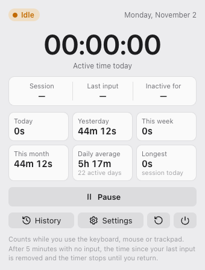
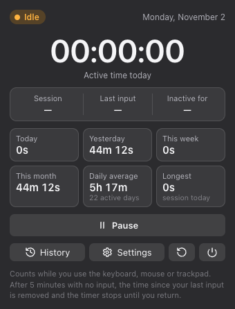
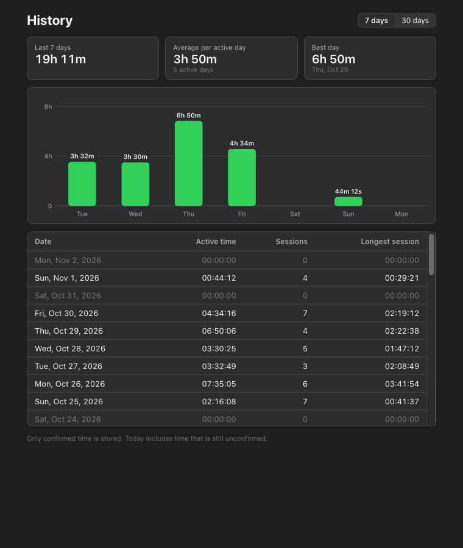

# Tracking Working Time

A macOS menu bar app that measures how long you actually work at your Mac, based on keyboard, mouse
and trackpad activity, with a strict rule for time spent away.

Built with **Electron, TypeScript and React**. No network access, no telemetry, no permissions to grant.

| Dashboard (light) | Dashboard (dark) | History |
| --- | --- | --- |
|  |  |  |

## Features

- **Live timer in the menu bar** (`⏱ 03:42:18`) with monospaced digits, coloured by state:
  green = active, amber = idle, grey = paused, sleeping or locked.
- **Automatic detection** of keyboard, mouse and trackpad activity across the whole system.
- **Strict five-minute rule** (configurable 1–240 min): unconfirmed time is removed retroactively.
- **Sleep, screen lock and user switching** are never counted.
- **Dashboard**: today, current session, last input, inactivity, plus yesterday, this week, this month,
  daily average and longest session.
- **History** with a 7- and 30-day bar chart and a table of every day.
- **Settings**: automatic tracking, threshold, strict/lenient mode, menu bar display, Launch at Login,
  light/dark/system appearance, CSV export, reset with confirmation.
- Daily totals split correctly at midnight and across daylight-saving changes; restarts keep only confirmed time.

## How the timer counts

The time after your most recent input is *provisional*.

- Another input within 5 minutes **confirms** the whole interval since the previous input.
- When 5 minutes pass with no input, the **entire** interval since the last input is **removed**,
  not just the part after 5 minutes. The timer freezes at the corrected total.
- The next input starts a new session, and the timer continues from the corrected total.

Example: you type at 10:00:00 and walk away. At 10:04:59 the timer still shows the extra 4 min 59 s.
At 10:05:00 it drops back to the 10:00:00 value and turns amber. Coming back at 10:20 starts counting
again from there; the 20 minutes away never count. *Lenient mode* keeps the 5 minutes instead.

## Getting started

Requirements: macOS 13 or later on Apple Silicon, Node.js 22.12 or later.

```bash
npm install
npm run dev        # run with hot reload
npm test           # 56 unit tests (Vitest)
npm run typecheck  # strict TypeScript for main, preload and UI
```

### Build and install the app

```bash
npm run dist
```

This runs the type check and tests, then creates `dist/mac-arm64/Tracking Working Time.app` and a zip.
Copy the app to `/Applications` and open it. The timer appears in the menu bar; the very first launch
opens the dashboard so you can see where it lives.

The app is signed ad hoc (no paid Apple Developer account is needed). A build you made yourself opens
normally. If you download the zip on another Mac, macOS blocks the first launch. Right-click the app,
choose **Open**, then confirm.

**Can't see the timer?** On a MacBook with a notch, macOS hides menu bar items that don't fit next to
the notch. Remove a few icons (hold ⌘ and drag them off), or turn off *Show timer* in Settings so only
the icon is shown. You can always open the dashboard by launching the app again from Spotlight.

### Launch at Login

Settings › General › **Launch at login**. This uses macOS's own login item service. If macOS asks
for approval, click **Open Login Items** and switch it on there.

### Try the rollback quickly

Set the inactivity limit to **1 min** in Settings. Use the Mac for a bit, then stop touching it and
watch the dashboard. An amber *Unconfirmed* card counts down, and at 1:00 the timer drops back to the
value it had at your last input.

### Check what the app can see

```bash
"/Applications/Tracking Working Time.app/Contents/MacOS/Tracking Working Time" --diagnostics
# {"idleSeconds":12,"idleState":"active"}
```

State changes are logged (times only) to `~/Library/Logs/Tracking Working Time/tracking.log`.

## Architecture

```
src/
  shared/      Types, day keys and formatting, used by both processes
  main/        Electron main process
    engine.ts            The single state machine that owns all time accounting
    activityMonitor.ts   Turns whole-second idle readings into input times
    controller.ts        Polling, sleep/lock events, saving, one shared snapshot
    idlePolicy.ts        Threshold and strict/lenient rule
    ledger.ts            Confirmed time per day and recent sessions
    persistence.ts       Atomic JSON storage and settings validation
    statistics.ts        Week, month and average figures; history rows
    trayView.ts          Menu bar item; trayIcon.ts draws the icon in code
    windows.ts           Popover and windows; security.ts locks everything down
  preload/     The narrow, typed bridge between the UI and the main process
  renderer/    React UI: Dashboard, Settings, History
tests/         Vitest suites with a simulated clock, idle clock and system events
```

**One engine, many views.** All accounting happens in `TimerEngine`, which never reads a clock
itself. Every input, tick and system event is passed in with its timestamp, so tests drive it with a
simulated clock and get exactly what the app does. The menu bar, popover and windows all render the
same snapshot.

**Two clocks.** Durations come only from the monotonic clock (`process.hrtime`), which ignores clock
changes and pauses during sleep. The wall clock is used only to decide which calendar day time belongs
to. Time that crosses midnight is split between the two days.

**Whole-second idle readings.** Electron reports idle time in whole seconds. A reading of *n* seconds
means the last input happened between *n* and *n*+1 seconds ago. `ActivityMonitor` keeps that range,
tells a new input apart from an old one, and always uses the latest possible time. As a result the
five-minute rule can never trigger early. A tested guarantee: a gap of 299.9 s never rolls back.

## Accuracy and limitations

- **Precision.** The threshold is never applied early, and at most about 1.5 s late (one-second idle
  resolution plus polling). Confirmed totals can be off by under a second per session.
- **Synthetic input counts.** The system idle clock cannot tell physical input from events created
  by software (remote desktop, automation tools, "mouse jigglers").
- **Sleep without a notification** is detected by comparing the two clocks. A *forward* change of
  the Mac's clock looks the same, so it ends the current session early. That loses at most the
  unconfirmed interval and never adds time.
- **Display sleep alone** is not reported by Electron. When the display sleeps because nothing was
  touched, the five-minute rule has normally ended the session already.
- **Time zone changes** apply to day boundaries after the app restarts.
- Fast user switching, lock and system sleep are reported by macOS and handled immediately. A missed
  lock notification is caught the next time input appears.

## Privacy and security

- Only *timestamps* are used. The app never sees which key was pressed, text, passwords, the
  clipboard, pointer positions, window titles or the screen. It uses no event tap and needs no
  Accessibility, Input Monitoring or Screen Recording permission.
- **No network.** Every web request is blocked in the main process. The page's Content Security
  Policy allows only the app's own files, and there are no analytics.
- **Hardened Electron**:
  - Renderers run with `sandbox`, `contextIsolation` and no Node.js.
  - The preload script exposes a small typed API.
  - Every IPC handler checks that the caller is the app's own page and validates its arguments.
  - Navigation, new windows, `<webview>` and permission requests are denied.
  - Electron fuses disable `RunAsNode`, `NODE_OPTIONS` and the inspector flags, and enforce ASAR
    integrity and loading only from the ASAR archive.
- Data stays on this Mac in `~/Library/Application Support/Tracking Working Time/` (`activity.json`
  and `settings.json`), readable only by your user. Files are written atomically. An unreadable file
  is set aside rather than overwritten.

## CSV export

```
date,active_seconds,active_time,sessions,longest_session_seconds,longest_session
2026-11-02,13338,03:42:18,5,2400,00:40:00
```

Only confirmed time is exported.

## Development notes

- `npm run screenshots` renders every screen in light and dark mode with sample data into
  `screenshots/` (used for the images above).
- CI (GitHub Actions) runs the type check, tests and a production build on every push.
- Uninstall: quit the app, turn off Launch at Login, delete it from `/Applications`, and optionally
  delete `~/Library/Application Support/Tracking Working Time`.

## License

MIT © 2026 Minh Khoi Ha. See [LICENSE](LICENSE).
